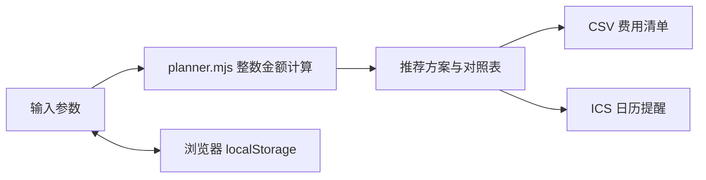

# 云券 · 续费规划助手

一个纯前端、可离线使用的云服务器续费规划工具。用于比较单张代金券在不同续费时长下的抵扣额、现金补差和券额利用率。

## 功能

- 输入实际月价、实例到期日、券额、订单门槛、券失效日与补差预算。
- 比较 6 / 12 / 24 / 36 个月范围内的每种续费方案。
- 在补差预算内优先最大化抵扣，再优先补差较低、时长较短的方案。
- 本机保存与恢复、CSV 费用表导出、ICS 到期提醒导出。
- 桌面及手机响应式页面，键盘可操作，无第三方 CDN 或数据收集。

## 运行

安装 Node.js 18 或以上版本后，在本目录执行 `npm start`，然后访问 http://127.0.0.1:4173 。无需安装任何项目依赖。也可使用任意静态 HTTP 服务器托管本目录。JavaScript 使用原生 ES Module，请不要通过 file:// 直接打开。

## 计算边界

金额按整数分计算；按月价乘月数线性估算。仅比较一张券，不叠加多张券。实际产品资格、地域、订购类型、折扣互斥、最长期限、券是否可重复使用、到期时刻与最终价格由官方结算页决定。失效日期等于今天时暂按当天可用估算。到期日期使用日历月相加，月末超出目标月时落到目标月最后一天。

日历文件仅包含未来的提醒日期；推荐续费到期提醒属于估算，并不表示已执行续费。所有计算不调用云 API、不读取账号凭据、不执行付款。

## 架构

## 文件

index.html：语义结构；style.css：响应式样式；app.mjs：交互及导出；planner.mjs：计算和日期逻辑。

本作品为独立规划工具，非华为云官方产品。示例参数仅用于演示。
